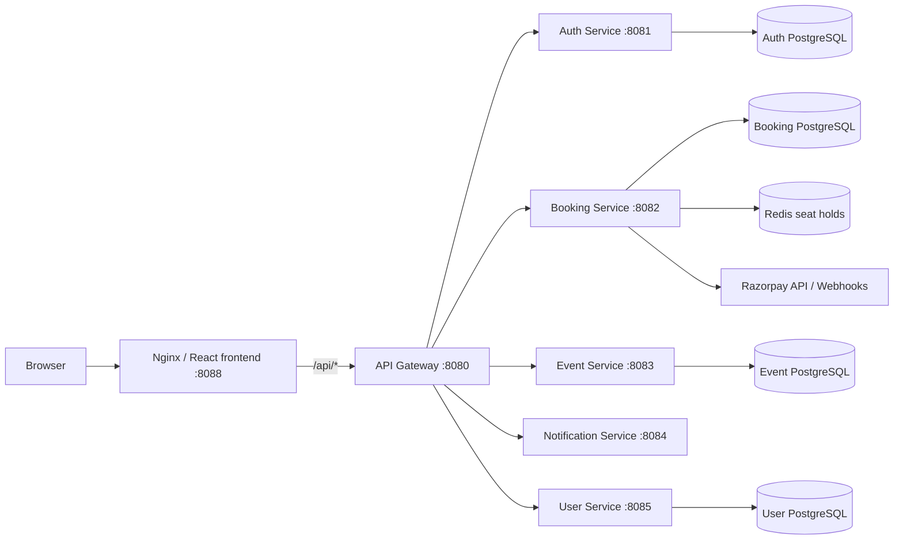

# EventHorizon — Event Ticket Booking System

A full-stack event discovery and ticket-booking application. EventHorizon brings event browsing, organizer event management, seat selection, time-limited reservations, Razorpay checkout, and booking management together behind a single web application and API gateway.

> **Project status:** This README documents the implementation currently present in this repository. The complete Docker Compose workflow is the recommended way to run the application. External payment and email integrations require your own provider credentials. Review the notes below before treating this project as a production deployment.

## Contents

- [Highlights](#highlights)
- [Technology stack](#technology-stack)
- [Architecture](#architecture)
- [Repository layout](#repository-layout)
- [Requirements](#requirements)
- [Quick start with Docker](#quick-start-with-docker-recommended)
- [Environment configuration](#environment-configuration)
- [Run and operate the application](#run-and-operate-the-application)
- [User workflows](#user-workflows)
- [Booking and seat concurrency](#booking-and-seat-concurrency)
- [Booking and payment states](#booking-and-payment-states)
- [API reference](#api-reference)
- [Run the frontend separately](#run-the-frontend-separately)
- [Build and test](#build-and-test)
- [Troubleshooting](#troubleshooting)
- [Security notes](#security-notes)
- [Limitations and production checklist](#limitations-and-production-checklist)

## Highlights

### Attendees

- Register as an attendee or sign in to an existing account.
- Discover events and browse event details, dates, venues, locations, categories, prices, and availability.
- Search the event catalogue by event name, category, or city.
- Choose ticket quantity and seats from an event-specific seating layout.
- View currently booked and temporarily blocked seats from the booking API.
- Create a booking and proceed to Razorpay Checkout.
- View booking status, booking ID, selected seats, and amount.
- Download a PDF ticket for a confirmed booking.
- Use the account area and switch between light and dark appearance.
- Request a password-reset link and set a new password.

### Organizers

- Register with the Organizer role.
- Open the Organizer Hub after signing in.
- Create events with a title, category, description, date, start/end time, venue, city, address, seat capacity, and ticket price.
- View events belonging to the signed-in organizer.
- Edit an existing event.
- Review organizer event and booking information in the organizer overview.

Event creation and modification are protected by organizer/admin authorization in the event service. The API also exposes event deletion, although a delete control is not currently presented in the organizer UI.

### Administrators

- Access the Admin area using an account with the ADMIN role.
- View active-user and published-event counts.
- View booking analytics, confirmed sales, and tickets sold when the booking analytics service is available.
- The user service exposes APIs for user lookup, activation/deactivation, and role changes. These are API capabilities; the current Admin page is primarily an analytics dashboard.

### Booking and payments

- Redis-backed, short-lived seat holds during checkout.
- PostgreSQL uniqueness constraint for permanent confirmed seat claims.
- Razorpay order creation and server-side payment signature verification.
- Razorpay webhook processing with signature validation.
- Payment-failure and checkout-cancellation handling.
- Expired or unsuccessful bookings release temporary seat holds.
- Payment reconciliation handles late payment callbacks and seat conflicts.
- Idempotent confirmation handling to avoid confirming the same booking more than once.

## Technology stack

| Layer | Technologies |
|---|---|
| Frontend | React, Vite, React Router, Tailwind CSS, Lucide React |
| Backend | Java 21, Spring Boot 3.3.5, Spring Cloud Gateway |
| API documentation | Springdoc OpenAPI / Swagger UI |
| Persistence | PostgreSQL 16, Spring Data JPA / Hibernate |
| Distributed seat holds | Redis 7 |
| Payments | Razorpay Java SDK and Razorpay Checkout |
| Web server | Nginx |
| Containers | Docker and Docker Compose |
| Build | Maven multi-module project; pnpm for the web client |

## Architecture

The browser uses the Nginx-served frontend. Nginx forwards requests under `/api` to the API gateway. The gateway routes each request to the relevant Spring Boot service.



| Component | Responsibility |
|---|---|
| `web-client` | EventHorizon React user interface and static assets |
| `api-gateway` | Single backend entry point, route forwarding, JWT-related gateway configuration, and API-doc routing |
| `auth-service` | Registration, login, access/refresh tokens, logout, token validation, and password recovery |
| `user-service` | User profiles, user lookup, activation state, and role management |
| `event-service` | Event creation, discovery, organizer event listing, updates, and ownership checks |
| `booking-service` | Booking lifecycle, seat availability, seat holds, confirmed-seat persistence, payment operations, and analytics |
| `notification-service` | Notification service module included in the backend architecture |
| `common_framework` | Shared models, API response utilities, and common exception handling |
| `docker` | Backend/web Dockerfiles and Nginx reverse-proxy configuration |

Each data-owning service has its own PostgreSQL database. Redis is used by booking-service for temporary seat reservations. The Compose file defines persistent volumes for the databases and Redis data.

## Repository layout

```text
.
├── api-gateway/
├── auth-service/
├── booking-service/
├── common_framework/
├── event-service/
├── notification-service/
├── user-service/
├── web-client/
│   ├── public/
│   └── src/
│       ├── components/
│       ├── data/
│       └── lib/
├── docker/
│   ├── Dockerfile.backend
│   ├── Dockerfile.web
│   └── nginx.conf
├── .env.example
├── compose.yaml
├── DOCUMENTATION.md
└── pom.xml
```

## Requirements

For the recommended Docker setup:

- Git
- Docker Desktop (Windows/macOS) or Docker Engine + Docker Compose plugin (Linux)
- Docker Compose v2 (the `docker compose` command)
- Internet access on first build so Docker can download base images and dependencies

For optional manual frontend/backend development:

- Node.js 22 or compatible version supported by the frontend dependencies
- pnpm (Corepack is used by the web Docker build)
- Java 21
- Maven 3.9+ (or the Maven wrapper provided in service modules)

## Quick start with Docker (recommended)

### 1. Clone the repository

```bash
git clone https://github.com/Divyasaxena1609/Event-Ticket-Booking-System.git
cd Event-Ticket-Booking-System
```

### 2. Start the complete application (no `.env` required)

For a local development/demo run, no environment file or manual database setup is required. The Compose file supplies clearly labelled local-only defaults for the four database passwords and the shared JWT key. From the repository root, run exactly:

```bash
docker compose up
```

This runs in the foreground and streams logs. To build images explicitly on the first run or after Dockerfile/dependency changes, use:

```bash
docker compose up --build
```

The first build may take several minutes and requires internet access to download base images and dependencies. Compose builds the backend services and web client, creates four PostgreSQL databases and Redis, waits for database/Redis health checks, and starts the application services.

### 3. Open the application

| Purpose | URL |
|---|---|
| EventHorizon web app | http://localhost:8088 |
| Web app (standard HTTP port) | http://localhost |
| Combined Swagger UI | http://localhost:8088/swagger-ui.html |
| Swagger UI (standard HTTP port) | http://localhost/swagger-ui.html |

The API gateway is internal to the Docker network and is not published as a host port by the Compose configuration. Use the frontend's `/api` proxy or the Nginx-served Swagger UI rather than trying to access the gateway directly from your host. The local Compose stack is intended for development/demo use; its default credentials and JWT key are public, predictable local defaults and must never be used in production.

## Environment configuration

The root `.env.example` is the source of the variable names expected by `compose.yaml`. Configure the following in your private root `.env` file.

| Variable | Required? | Purpose |
|---|---:|---|
| `AUTH_DB_USERNAME` | Yes (default provided) | Auth database username |
| `AUTH_DB_PASSWORD` | **Yes** | Auth database password |
| `USER_DB_USERNAME` | Yes (default provided) | User database username |
| `USER_DB_PASSWORD` | **Yes** | User database password |
| `EVENT_DB_USERNAME` | Yes (default provided) | Event database username |
| `EVENT_DB_PASSWORD` | **Yes** | Event database password |
| `BOOKING_DB_USERNAME` | Yes (default provided) | Booking database username |
| `BOOKING_DB_PASSWORD` | **Yes** | Booking database password |
| `SECURITY_JWT_SECRET` | **Yes** | Shared JWT signing/validation secret for auth-service and gateway |
| `RAZORPAY_KEY_ID` | Optional for startup; required for live checkout | Razorpay API key ID |
| `RAZORPAY_KEY_SECRET` | Optional for startup; required for live checkout | Razorpay API key secret |
| `RAZORPAY_WEBHOOK_SECRET` | Optional for startup; required for webhook verification | Secret configured for the Razorpay webhook |
| `SMTP_HOST` | Optional for basic startup | SMTP server hostname |
| `SMTP_PORT` | Optional; defaults to 587 | SMTP server port |
| `SMTP_USERNAME` | Optional | SMTP account username |
| `SMTP_PASSWORD` | Optional | SMTP account password/app password |
| `SMTP_AUTH` | Optional; example sets true | Whether SMTP authentication is enabled |
| `SMTP_STARTTLS` | Optional; example sets true | Whether SMTP STARTTLS is enabled |
| `MAIL_FROM` | Optional | Sender address used by the mail configuration |
| `PASSWORD_RESET_FRONTEND_URL` | Optional; defaults to localhost | Frontend base URL used for password-reset links |

**Important configuration notes**

- For the zero-configuration local run, all database credentials and `SECURITY_JWT_SECRET` have local-only defaults; `.env` is optional.
- To override defaults, copy `.env.example` to `.env` and set your own values. Compose automatically reads the root `.env` file.
- Use different strong passwords for the four databases outside a disposable local demo.
- Keep `SECURITY_JWT_SECRET` identical for auth-service and api-gateway. Override the public local default anywhere beyond a local demo.
- Razorpay credentials are not required to start the stack. Real checkout and webhook verification require valid Razorpay configuration. Empty values disable the credentials configuration; payment bean/client initialization and the full no-credentials runtime still need to be verified by running the stack.
- SMTP settings are needed for email-based password recovery to deliver email. SMTP is disabled by default for the local zero-configuration run; without working SMTP settings, the email workflow cannot deliver a reset message.
- Set `PASSWORD_RESET_FRONTEND_URL` to the externally reachable frontend URL when deploying outside local development.
- Never add real credentials to `.env.example`, source code, Dockerfiles, or README files.

## Run and operate the application

### Check service status

```bash
docker compose ps
```

### Follow all service logs

```bash
docker compose logs -f
```

### Follow one service

```bash
docker compose logs -f api-gateway
docker compose logs -f auth-service
docker compose logs -f booking-service
docker compose logs -f event-service
docker compose logs -f user-service
docker compose logs -f notification-service
docker compose logs -f web-client
```

### Restart a service

```bash
docker compose restart booking-service
```

### Rebuild after code or dependency changes

```bash
docker compose up --build -d
```

### Run in the background (optional)

```bash
docker compose up --build -d
```

### Stop containers but keep persistent data

```bash
docker compose down
```

### Stop containers and delete all Compose database/Redis volumes

```bash
docker compose down -v
```

> **Warning:** `docker compose down -v` permanently deletes the PostgreSQL and Redis data stored in the Compose volumes. Use it only when you intentionally want a clean local database.

## User workflows

### Attendee journey

1. Open the web app and browse the event catalogue.
2. Open an event to review its date, time, venue, description, and ticket price.
3. Register as an attendee or sign in.
4. Choose the ticket quantity.
5. Select available seats from the seating map.
6. Review the booking summary and continue to checkout.
7. The backend creates a booking and temporarily holds the selected seats.
8. The frontend opens Razorpay Checkout using an order created by booking-service.
9. After payment, the frontend submits payment details for server-side verification. Razorpay webhooks provide a separate server-to-server confirmation path.
10. On successful verification, the booking is confirmed and the seats become permanently claimed.
11. Open **My bookings** to review the booking and download the PDF ticket.

### Organizer journey

1. Register and select the Organizer role.
2. Sign in and open **Organizer Hub**.
3. Select **Create event**.
4. Enter the event details, date/time, venue, capacity, and ticket price.
5. Save the event. It is associated with the organizer's user UUID.
6. Return to the Organizer Hub to review or edit your events.

### Administrator journey

1. Sign in with an account that has the ADMIN role.
2. Open **Admin** from the navigation.
3. Review active users, published events, confirmed sales, tickets sold, and booking counts where the analytics API is available.

Role assignment and account provisioning should be controlled carefully in a real deployment. Do not assume that a public registration form is an acceptable way to grant administrator access.

## Booking and seat concurrency

The booking implementation uses two complementary mechanisms to prevent two attendees from obtaining the same seat.

### Temporary Redis seat hold

- booking-service creates a Redis key for each event/seat combination.
- The hold uses Redis `SETNX` semantics so only one request can acquire a seat at a time.
- Holds expire after **12 minutes**.
- If a request cannot acquire every requested seat, any holds acquired during that request are rolled back.
- The Docker profile requires Redis; the local in-memory fallback is not used in the Docker profile.

### Permanent PostgreSQL seat claim

- When payment is confirmed, booking-service writes the seat claim to `confirmed_seats`.
- PostgreSQL enforces uniqueness on the combination of `event_uuid` and `seat_number`.
- The database constraint is the final protection against duplicate confirmed seats, even if a temporary Redis hold expires or multiple booking-service instances run.

### Late payment handling

Payment callbacks can arrive after a temporary reservation expires. The payment reconciliation logic checks whether the seats have already been claimed. If they are still available, the booking can be confirmed; if another booking has claimed them, the late payment is handled as a refund case rather than creating a duplicate confirmed seat.

## Booking and payment states

| State | Meaning |
|---|---|
| `CREATED` | Booking created; payment is pending and temporary seat holds are active |
| `CONFIRMED` | Payment verified and seats permanently claimed |
| `FAILED` | Payment failed; temporary holds are released |
| `CANCELLED` | Booking cancelled; temporary holds are released |
| `EXPIRED` | Booking/hold expired before successful confirmation |
| `REFUNDED` | A late payment could not be matched to seats that remained available and was recorded for refund |

## API reference

All application API requests from the browser are sent through the Nginx `/api` prefix. The gateway removes that prefix and forwards requests to the appropriate service.

| Public gateway path | Service | Purpose |
|---|---|---|
| `/api/auth/**` | auth-service | Registration, login, refresh, logout, validation, password recovery |
| `/api/event/**` | event-service | Event listing, details, organizer event management |
| `/api/booking/**` | booking-service | Booking creation, lookup, seat availability, release, cancellation, analytics |
| `/api/payment/**` | booking-service | Razorpay order, verification, failure, webhook |
| `/api/user/**` | user-service | User profile and role/account operations |
| `/api/notification/**` | notification-service | Notification service route |

The gateway maps the public singular route prefixes to the service controller paths (for example, `/api/event` to the event service's `/events` controller).

### Swagger UI

Open:

```text
http://localhost:8088/swagger-ui.html
```

Use the specification selector to switch between:

- Authentication
- Events
- Bookings and Payments
- Users

For protected operations:

1. Call `POST /auth/login` with a valid account.
2. Copy the returned access token.
3. Select **Authorize** in Swagger UI.
4. Enter `Bearer <access-token>`.
5. Execute the protected request.

The gateway exposes the service specifications at:

| Specification | URL |
|---|---|
| Authentication | `/v3/api-docs/auth` |
| Events | `/v3/api-docs/events` |
| Bookings and payments | `/v3/api-docs/booking` |
| Users | `/v3/api-docs/users` |

### Main endpoint groups

These are endpoint groups, not a replacement for the live Swagger schemas and request DTOs.

**Authentication**
- `POST /auth/register`
- `POST /auth/login`
- `POST /auth/refresh`
- `POST /auth/logout`
- `POST /auth/forgot-password`
- `POST /auth/reset-password`
- `GET /auth/validate`

**Events**
- `GET /event`
- `GET /event/{eventUuid}`
- `POST /event`
- `GET /event/organizer/me`
- `PUT /event/{eventUuid}`
- `DELETE /event/{eventUuid}`

**Bookings**
- `POST /booking`
- `GET /booking/{bookingUUID}`
- `GET /booking/user/{userId}`
- `GET /booking/event/{eventUuid}`
- `GET /booking/event/{eventUuid}/seats`
- `POST /booking/event/{eventUuid}/seat-prices`
- `POST /booking/{bookingUUID}/release`
- `DELETE /booking/{bookingUUID}`
- `GET /booking/admin/analytics`

**Payments**
- `POST /payment/create-order`
- `POST /payment/verify`
- `POST /payment/fail`
- `POST /payment/webhook`

**Users**
- `GET /user`
- `GET /user/{userUuid}`
- `GET /user/email/{email}`
- `POST /user`
- `PUT /user/{userUuid}`
- `DELETE /user/{userUuid}`
- `PATCH /user/{userUuid}/activate`
- `PATCH /user/{userUuid}/deactivate`
- `PATCH /user/{userUuid}/role/{role}`

The gateway and service authorization rules apply to protected endpoints. Use Swagger to confirm required headers, roles, payload fields, and response schemas before integrating another client.

## Run the frontend separately

The frontend source is in `web-client/`. It uses Vite and the API helper in `src/lib/api.js`. During Vite development, `/api` is proxied to `http://localhost:8080`.

Install frontend dependencies:

```bash
cd web-client
corepack enable
pnpm install
```

Start the Vite development server:

```bash
pnpm dev
```

The frontend development server is separate from the backend. Make sure the API gateway is reachable at `http://localhost:8080` before using API-backed screens. The recommended Compose deployment does not publish the gateway port to the host; for local Vite development, configure a suitable local backend/gateway run profile or adjust your local-only Compose configuration to expose the gateway. Do not expose the gateway publicly without reviewing its security configuration.

Create a production frontend bundle:

```bash
pnpm build
pnpm preview
```

## Build and test

### Build all Maven modules

From the repository root:

```bash
mvn clean verify
```

Or use a Maven wrapper from a service directory if Maven is not installed and the wrapper is available:

**Windows**
```powershell
.\mvnw.cmd clean verify
```

**macOS / Linux**
```bash
./mvnw clean verify
```

### Run focused service tests

From the repository root, examples:

```bash
mvn -pl booking-service -am test
mvn -pl event-service -am test
mvn -pl auth-service -am test
mvn -pl user-service -am test
```

The repository includes booking, payment, seat-lock, event, authentication, and user-service test classes. Run the test suite in your own environment to verify the current checkout and dependency state.

## Troubleshooting

### Docker says a required environment variable is missing

- Confirm that the file is named exactly `.env`.
- Confirm it is in the repository root beside `compose.yaml`.
- Replace all required database password and JWT placeholders.
- Re-run `docker compose up --build -d`.

### A service is unhealthy or keeps restarting

Check its logs:

```bash
docker compose ps
docker compose logs --tail=200 auth-service
docker compose logs --tail=200 booking-service
```

Also check the health status of the relevant PostgreSQL container and Redis:

```bash
docker compose logs --tail=100 booking-db
docker compose logs --tail=100 redis
```

### Events or bookings do not load

- Confirm all containers are running: `docker compose ps`.
- Inspect `api-gateway`, `event-service`, `booking-service`, and `user-service` logs.
- Open the Swagger UI and test the corresponding endpoint.
- Confirm the event exists in the event database and that the user/session has the expected role.

### Razorpay checkout does not open or payment fails

- Configure valid Razorpay test-mode or live-mode credentials in the root `.env`.
- Restart/recreate booking-service after changing environment values: `docker compose up -d --force-recreate booking-service`.
- Confirm the frontend can load Razorpay Checkout and that the backend can create and verify orders.
- Configure the webhook URL and matching webhook secret in the Razorpay dashboard if webhook confirmation is being used.
- Never use live credentials in a local test environment unless you intend to process real payments.

### Password-reset email is not delivered

- Configure SMTP host, port, username, password/app password, authentication, and STARTTLS settings.
- Set `MAIL_FROM` to a sender accepted by your SMTP provider.
- Check auth-service logs for SMTP connection/authentication errors.
- Confirm `PASSWORD_RESET_FRONTEND_URL` points to the frontend that the recipient can access.

### Port 80 or 8088 is already in use

Stop the application using that port or change the host-side port mapping for `web-client` in `compose.yaml`. Keep the container-side Nginx port at 80.

## Security notes

- Never commit `.env`, API keys, database passwords, JWT secrets, webhook secrets, SMTP passwords, private keys, or real user data.
- Use the root `.env.example` only as a list of variable names and safe placeholders.
- Rotate any credential that has ever been committed or otherwise exposed. Removing a value from the latest file or rewriting Git history does not make an exposed credential safe again.
- Store production secrets in a managed secret store or deployment platform's encrypted environment settings.
- Use HTTPS in production and restrict CORS to the exact frontend origins that should be allowed.
- Protect administrator provisioning and role changes; do not allow untrusted users to grant themselves privileged roles.
- Back up databases before upgrades or destructive maintenance.
- Do not publish database or Redis ports to the public internet.
- Review authentication, authorization, rate limiting, logging, webhook handling, and data-retention policies before production use.

## Limitations and production checklist

Before deploying this project for real users, review and validate at least the following:

- [ ] Run the complete Maven test suite and frontend production build.
- [ ] Run an end-to-end test of registration, login, event creation, booking, payment, webhook confirmation, cancellation, expiry, and ticket download.
- [ ] Verify the ADMIN role is provisioned securely and cannot be self-assigned through public registration.
- [ ] Verify every user-facing API enforces the intended role and resource ownership checks.
- [ ] Configure real SMTP and verify password-reset delivery.
- [ ] Configure Razorpay test mode, webhook signature verification, idempotency, and refund operations before enabling live payments.
- [ ] Configure HTTPS, production CORS, domain names, backups, monitoring, and alerting.
- [ ] Confirm database migration and backup/restore procedures.
- [ ] Review notification-service behavior and confirm which notification workflows are implemented and enabled.
- [ ] Remove generated build output, dependency caches, IDE metadata, and other non-source artifacts from version control.
- [ ] Scan the full Git history and rotate all credentials that were ever exposed.

This repository is a software project and starting point, not a claim of payment-provider certification or production security certification.

## Contributing

1. Fork the repository.
2. Create a focused feature branch.
3. Keep credentials and local environment files out of commits.
4. Add or update tests for behavior changes.
5. Run the relevant Maven tests and frontend build.
6. Open a pull request describing the change and how it was tested.

## License

No license is currently declared in the repository. Unless a license is added, the default copyright rules apply; do not assume the project is available for unrestricted reuse.
